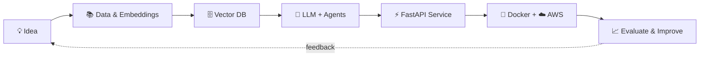

<!-- ═══════════════════════  HEADER  ═══════════════════════ -->
<div align="center">


<a href="https://github.com/Owaiskhan-29">
  
</a>

<br/>

<a href="https://www.linkedin.com/in/owais-khan-2906k/"></a>
<a href="mailto:owaiskhan.2906@gmail.com?subject=Let's%20collaborate%20%F0%9F%9A%80&body=Hi%20Owais%2C%20I%20saw%20your%20GitHub%20profile..."></a>
<a href="https://github.com/Owaiskhan-29?tab=repositories"></a>

<br/><br/>


</div>


<!-- ═══════════════════════  ABOUT  ═══════════════════════ -->
## 👨‍💻 About Me

<div align="center">
<table>
<tr>
<td width="62%" valign="middle">

### Hey there! 👋 I'm **Owais**

An **AI/ML Engineer** who loves building intelligent applications that actually *do* something useful.

```python
class OwaisKhan:
    role      = "AI/ML Engineer"
    location  = "India 🇮🇳"
    focus     = ["Agentic AI", "RAG", "LLM Apps", "Voice AI"]
    stack     = ["Python", "FastAPI", "LangChain", "LangGraph"]
    currently = "Building multi-agent workflows 🤖"
    mission   = "Turn innovative ideas into useful, intelligent software"

    def say_hi(self):
        return "Let's build something awesome together! 🚀"
```

</td>
<td width="38%" align="center" valign="middle">


<br/><br/>

**Think AI. Build Smart. Keep Innovating.**

</td>
</tr>
</table>
</div>

### 🔭 What I'm up to

| | Focus | Status |
|:--:|---|:--:|
| 🤖 | Agentic AI, tool calling & multi-agent workflows |  |
| 🔎 | Retrieval-Augmented Generation & semantic search |  |
| 🎙️ | Real-time multilingual voice AI |  |
| ⚡ | Production APIs with Python & FastAPI |  |
| 🌱 | Evaluation, observability & reliability for LLM apps |  |


<!-- ═══════════════════════  TECH STACK  ═══════════════════════ -->
## 🛠️ Tech Stack

<div align="center">

### 💻 Languages & Core


### 🤖 AI · LLMs · Agent Frameworks


### 📊 Machine Learning & Data


### 🔍 Vector DBs & Data Stores


### ⚙️ Backend · Cloud · DevOps


</div>


<!-- ═══════════════════════  DASHBOARD  ═══════════════════════ -->
## ⚡ AI Engineering Dashboard

<div align="center">
<table>
<tr>
<td align="center" width="33%"><h3>🤖</h3><b>Agentic AI</b><br/><sub>Agents · Tool calling · Orchestration</sub></td>
<td align="center" width="33%"><h3>🔎</h3><b>RAG Systems</b><br/><sub>Retrieval · Embeddings · Reranking</sub></td>
<td align="center" width="33%"><h3>🧩</h3><b>LLM Engineering</b><br/><sub>Prompting · Structured outputs</sub></td>
</tr>
<tr>
<td align="center"><h3>🎙️</h3><b>Voice AI</b><br/><sub>Real-time · Multilingual</sub></td>
<td align="center"><h3>⚡</h3><b>AI APIs</b><br/><sub>Python · FastAPI · WebSockets</sub></td>
<td align="center"><h3>🗄️</h3><b>Vector Search</b><br/><sub>Semantic retrieval</sub></td>
</tr>
</table>
</div>

### 🧬 How I build an AI system




<!-- ═══════════════════════  PROJECTS  ═══════════════════════ -->
## 🚀 Featured Projects

<div align="center">

<a href="https://github.com/Owaiskhan-29?tab=repositories"></a>
<a href="https://github.com/Owaiskhan-29?tab=stars"></a>

<br/><br/>

<!--
  ✏️ ADD YOUR BEST PROJECTS: replace REPO_NAME_1 / REPO_NAME_2 with your real repo names,
  then remove the comment markers around this block.

<a href="https://github.com/Owaiskhan-29/REPO_NAME_1">
  
</a>
<a href="https://github.com/Owaiskhan-29/REPO_NAME_2">
  
</a>
-->

</div>


<!-- ═══════════════════════  STATS  ═══════════════════════ -->
## 📊 GitHub Analytics

<div align="center">


<br/><br/>


<br/><br/>


<br/>


</div>

### 🐍 Contribution Snake

<div align="center">
<picture>
  <source media="(prefers-color-scheme: dark)" srcset="https://raw.githubusercontent.com/Owaiskhan-29/Owaiskhan-29/output/github-contribution-grid-snake-dark.svg"/>
  <source media="(prefers-color-scheme: light)" srcset="https://raw.githubusercontent.com/Owaiskhan-29/Owaiskhan-29/output/github-contribution-grid-snake.svg"/>
  
</picture>
</div>


<!-- ═══════════════════════  ROADMAP  ═══════════════════════ -->
## 🎯 Learning Roadmap  <sub>(click to expand)</sub>

<details>
<summary><b>🤖 Agentic AI & Multi-Agent Systems</b> &nbsp;</summary>
<br/>

- [x] Build LLM apps with tool calling
- [ ] Advanced agent orchestration (LangGraph)
- [ ] Reusable multi-agent workflows
- [ ] Agent evaluation & reliability

</details>

<details>
<summary><b>🔎 Advanced RAG</b> &nbsp;</summary>
<br/>

- [x] Embeddings + vector search basics
- [ ] Hybrid search (BM25 + vectors)
- [ ] Reranking & retrieval evaluation
- [ ] Smarter chunking strategies & grounding

</details>

<details>
<summary><b>🎙️ Real-Time Voice AI</b> &nbsp;</summary>
<br/>

- [ ] Real-time audio pipelines
- [ ] WebSocket streaming
- [ ] Latency & interruption handling
- [ ] Multilingual voice experiences

</details>

<details>
<summary><b>☁️ Production AI Engineering</b> &nbsp;</summary>
<br/>

- [x] AWS Cloud Practitioner foundations
- [ ] Docker-based deployments
- [ ] LLM observability & tracing
- [ ] Automated testing & evaluation for AI systems

</details>


<!-- ═══════════════════════  CERTS  ═══════════════════════ -->
## 🏆 Certifications

<div align="center">


</div>

<!-- ═══════════════════════  BEYOND CODE  ═══════════════════════ -->
## 💡 Beyond the Code

<div align="center">

| ✨ | What motivates me |
|:---:|---|
| 🧠 | Turning complex problems into practical AI solutions |
| 🧪 | Experimenting with emerging technologies |
| 🌍 | Learning from the developer community |
| 🚀 | Building, improving, and sharing useful software |

</div>

<details>
<summary><b>💭 My developer philosophy</b></summary>
<br/>

> *The best way to understand technology is to build with it.*
> I enjoy experimenting, exploring how systems work under the hood, and turning new ideas into practical applications.

</details>

<details>
<summary><b>🤝 Ways we can work together</b></summary>
<br/>

- 🤖 Building **agentic / LLM-powered** applications
- 🔎 Designing **RAG pipelines** and semantic search
- 🎙️ Prototyping **voice AI** experiences
- 🌐 **Open-source** AI/ML contributions

👉 [**Email me with your idea**](mailto:owaiskhan.2906@gmail.com?subject=Project%20Idea%20%F0%9F%92%A1) or [**message me on LinkedIn**](https://www.linkedin.com/in/owais-khan-2906k/)

</details>


<!-- ═══════════════════════  CONNECT  ═══════════════════════ -->
<div align="center">

## 🤝 Let's Connect!

### Have an interesting AI idea? Let's build something awesome together.

<a href="https://www.linkedin.com/in/owais-khan-2906k/"></a>
<a href="mailto:owaiskhan.2906@gmail.com"></a>
<a href="https://github.com/Owaiskhan-29"></a>

<br/><br/>


<br/>


</div>
