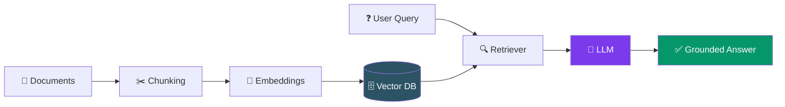
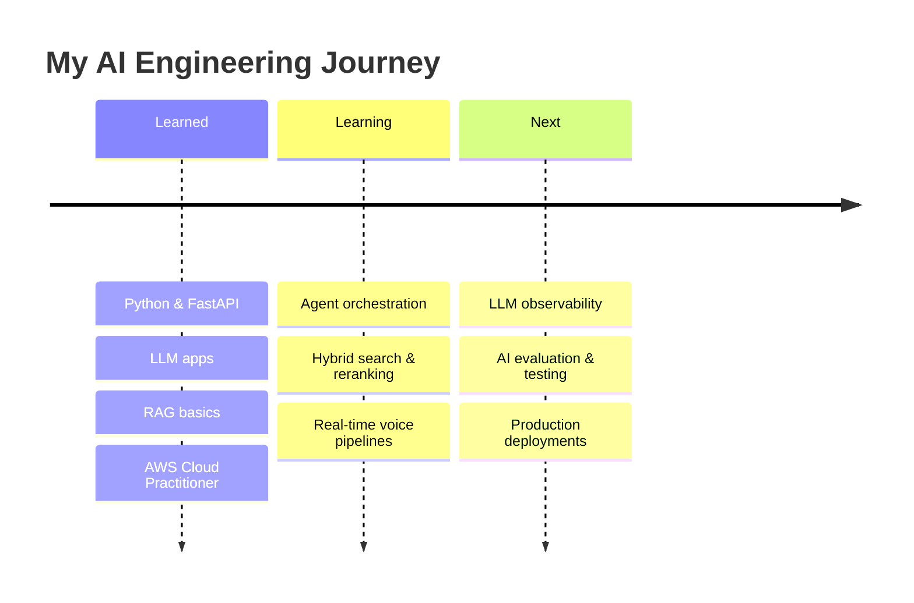

<div align="center">


<a href="https://github.com/Owaiskhan-29">
  
</a>

<br>

<a href="https://www.linkedin.com/in/owais-khan-2906k/"></a>
<a href="mailto:owaiskhan.2906@gmail.com"></a>
<a href="https://github.com/Owaiskhan-29?tab=repositories"></a>

<br><br>


</div>

---

## 👨‍💻 About Me

<table>
<tr>
<td width="62%" valign="top">

I'm **Owais Khan**, an AI/ML engineer who loves building intelligent applications that actually get used.

I work across the full stack of an AI product: from **retrieval and LLM orchestration** to **APIs and deployment**.

```python
class Owais:
    role     = "AI/ML Engineer"
    focus    = ["Agentic AI", "RAG", "Voice AI", "LLM Apps"]
    backend  = ["Python", "FastAPI"]
    cert     = "AWS Certified Cloud Practitioner"
    mission  = "Turn innovative ideas into useful, intelligent software"
    status   = "Always learning, always building 🚀"
```

</td>
<td width="38%" align="center" valign="middle">


<br><br>

**Think AI. Build Smart. Keep Innovating.**

</td>
</tr>
</table>

---

## 🎯 Now · Next · Later

| 🔥 Now | 🔜 Next | 🌅 Later |
|:---|:---|:---|
| Building RAG & agent-based apps | Hybrid search + reranking | LLM observability & tracing |
| FastAPI backends for AI services | Multi-agent workflows (LangGraph / CrewAI) | Automated evaluation for AI systems |
| Real-time voice AI experiments | Low-latency, interruptible voice pipelines | Multilingual voice experiences |

---

## 💬 Ask Me About... *(click a card)*

<div align="center">

<a href="mailto:owaiskhan.2906@gmail.com?subject=Question%20about%20RAG&body=Hi%20Owais%2C%20I%20wanted%20to%20ask%20about...">
  
</a>
<a href="mailto:owaiskhan.2906@gmail.com?subject=Question%20about%20Agentic%20AI&body=Hi%20Owais%2C%20I%20wanted%20to%20ask%20about...">
  
</a>
<a href="mailto:owaiskhan.2906@gmail.com?subject=Question%20about%20Voice%20AI&body=Hi%20Owais%2C%20I%20wanted%20to%20ask%20about...">
  
</a>
<a href="mailto:owaiskhan.2906@gmail.com?subject=Let's%20collaborate!&body=Hi%20Owais%2C%20I%20have%20an%20idea...">
  
</a>

</div>

---

## 🛠️ Tech Stack

<div align="center">

<br>
<br>


<br><br>


</div>

<details>
<summary><b>📖 Click to see how I think about each layer</b></summary>
<br>

| Layer | What I use it for |
|:---|:---|
| 🤖 **Agents & LLMs** | OpenAI, LangChain, LangGraph, CrewAI: orchestration, tool calling, multi-agent flows |
| 🔎 **Retrieval** | ChromaDB, FAISS, Pinecone: embeddings and semantic search |
| ⚙️ **Backend** | FastAPI, Flask, Node.js: serving models and agents as APIs |
| 📊 **ML / Data** | PyTorch, TensorFlow, scikit-learn, Pandas, NumPy, OpenCV |
| ☁️ **Deploy** | Docker, AWS, Git/GitHub |

</details>

---

## 🧬 How I Build a RAG System



---

## 🚀 Featured Projects *(click to expand)*

> 💡 Replace the placeholders below with your real projects, and keep the same format.

<details>
<summary><b>🔎 Project 1: Your RAG Project Name</b></summary>
<br>

**Problem:** What it solves in one line.
**How it works:** Documents → chunking → embeddings → vector DB → LLM answer.
**Stack:** `Python` `FastAPI` `LangChain` `ChromaDB` `OpenAI`
**Links:** [Repo](https://github.com/Owaiskhan-29) · [Demo](#) · [Write-up](#)

</details>

<details>
<summary><b>🤖 Project 2: Your Agentic AI Project Name</b></summary>
<br>

**Problem:** What it solves in one line.
**How it works:** Planner agent → tool-calling agents → final response.
**Stack:** `Python` `LangGraph` `CrewAI` `OpenAI`
**Links:** [Repo](https://github.com/Owaiskhan-29) · [Demo](#) · [Write-up](#)

</details>

<details>
<summary><b>🎙️ Project 3: Your Voice AI Project Name</b></summary>
<br>

**Problem:** What it solves in one line.
**How it works:** Mic → streaming speech-to-text → LLM → text-to-speech, over WebSockets.
**Stack:** `Python` `FastAPI` `WebSockets` `OpenAI`
**Links:** [Repo](https://github.com/Owaiskhan-29) · [Demo](#) · [Write-up](#)

</details>

<div align="center">

<a href="https://github.com/Owaiskhan-29?tab=repositories"></a>
<a href="https://github.com/Owaiskhan-29?tab=stars"></a>

</div>

> 📌 **Tip:** Pin your 6 best repositories on your profile. They show up right under this README.

---

## 📊 GitHub Analytics

<div align="center">


<br><br>


<br><br>


<br><br>


</div>

<details>
<summary><b>🐍 Contribution snake</b></summary>
<br>
<div align="center">

</div>
</details>

---

## 🗺️ Learning Roadmap



<details>
<summary><b>🤖 Agentic AI & Multi-Agent Systems</b></summary>

- [ ] Advanced agent orchestration
- [ ] Tool calling and structured outputs
- [ ] Reusable multi-agent workflows
- [ ] Agent evaluation and reliability

</details>

<details>
<summary><b>🔎 Advanced RAG</b></summary>

- [ ] Hybrid search
- [ ] Reranking and retrieval evaluation
- [ ] Document chunking strategies
- [ ] Better grounding and response quality

</details>

<details>
<summary><b>🎙️ Real-Time Voice AI</b></summary>

- [ ] Real-time audio pipelines
- [ ] WebSocket communication
- [ ] Latency and interruption handling
- [ ] Multilingual voice experiences

</details>

<details>
<summary><b>☁️ Production AI Engineering</b></summary>

- [ ] Docker-based deployments
- [ ] LLM observability and tracing
- [ ] Automated testing for AI systems
- [ ] AI application evaluation

</details>

---

## 🏆 Certifications

<div align="center">


</div>

---

## 💡 Beyond the Code

<details>
<summary><b>💭 My developer philosophy</b></summary>
<br>

I believe the best way to understand technology is to build with it. I enjoy experimenting, exploring how systems work under the hood, and turning new ideas into practical applications.

</details>

<details>
<summary><b>⚡ Fun facts</b></summary>
<br>

- 🧪 I learn best by breaking things and rebuilding them
- 🎧 Voice AI fascinates me: talking to software feels like the future
- 🌱 Always experimenting with something new

</details>

<div align="center">


</div>

---

## 🤝 Let's Connect!

<div align="center">

### Have an interesting AI idea? Let's build something awesome.

<a href="https://www.linkedin.com/in/owais-khan-2906k/"></a>
<a href="mailto:owaiskhan.2906@gmail.com"></a>
<a href="https://github.com/Owaiskhan-29"></a>

<br><br>

**✨ Think AI. Build Smart. Keep Innovating.**


</div>
